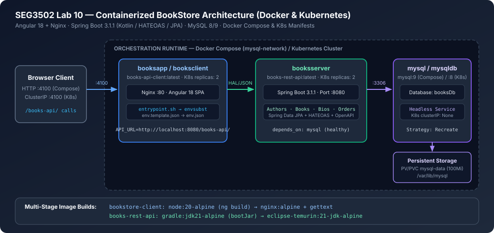
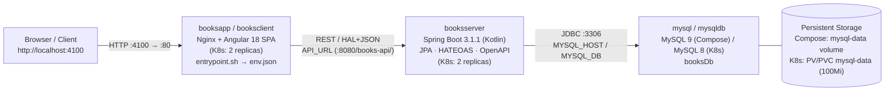
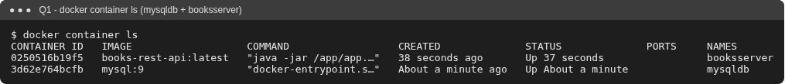
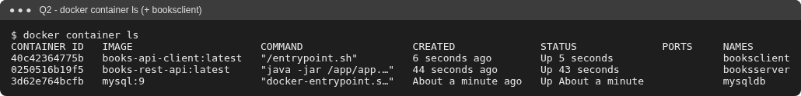
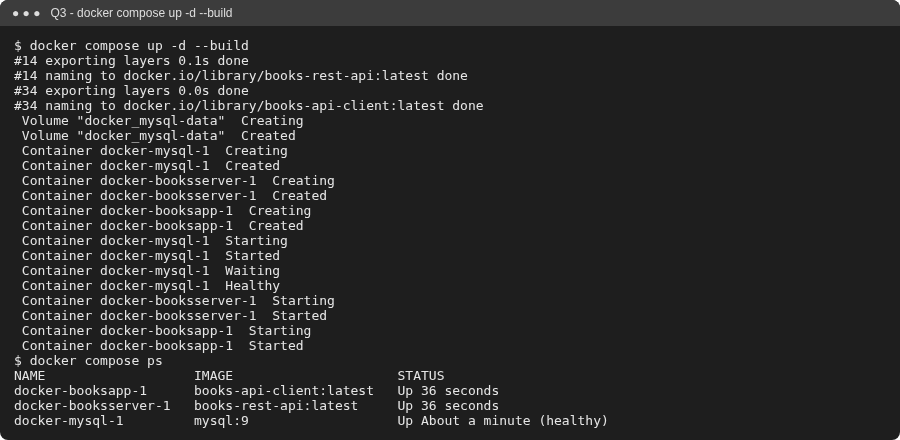
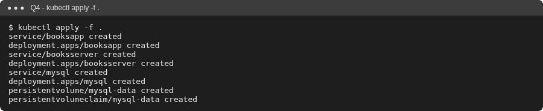
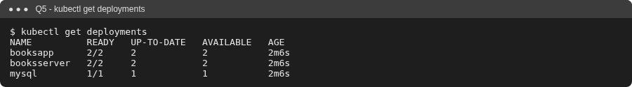
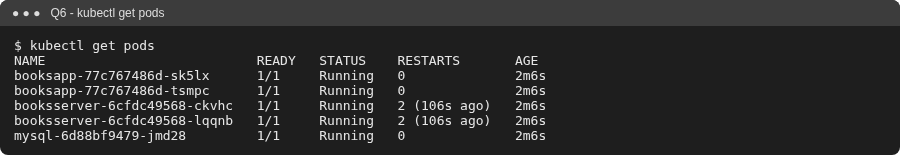

# SEG3502 — Lab 10: Containerized BookStore (Docker, Docker Compose & Kubernetes)

> **Course:** SEG3502 — Distributed Software Design (*Conception de logiciels distribués*)  
> **Authors:** Anwar & Manasse  
> **Scope:** Multi-stage Docker builds, Docker Compose service orchestration, and Kubernetes (`Deployment`, `Service`, `PersistentVolume` / `PersistentVolumeClaim`) manifests for the BookStore distributed application.

---

## English Summary

This repository containerizes and orchestrates the three-tier **BookStore** distributed application (`bookstore-client` Angular SPA + `books-rest-api` Kotlin/Spring Boot HATEOAS REST API + MySQL):
- **Multi-Stage Dockerfiles:** Builds the Spring Boot fat JAR (`gradle:jdk21-alpine` → `eclipse-temurin:21-jdk-alpine`) and Angular 18 production bundle (`node:20-alpine` → `nginx:alpine`), injecting `API_URL` at container startup via `entrypoint.sh` and `envsubst` (`env.template.json` → `env.json`).
- **Docker Compose:** Orchestrates `mysql` (`mysql:9` with healthcheck & named volume `mysql-data`), `booksserver`, and `booksapp` on `mysql-network` (plus an optional `docker-compose.hostnet.yml` override for environments without Docker iptables).
- **Kubernetes Manifests:** Deploys `mysql` (headless `Service`, `Recreate` strategy, `100Mi` PV/PVC), `booksserver` (`2` replicas, `ClusterIP :8080`, `preStop` graceful drain), and `booksapp` (`2` replicas, `ClusterIP :4100 → 80`).

## Résumé en français

Ce dépôt conteneurise et orchestre l'application distribuée **BookStore** à trois niveaux (client Angular `bookstore-client` + API REST Spring Boot/Kotlin HATEOAS `books-rest-api` + MySQL) :
- **Dockerfiles multi-étapes :** Construction du JAR Spring Boot (`gradle:jdk21-alpine` → `eclipse-temurin:21-jdk-alpine`) et du bundle Angular 18 (`node:20-alpine` → `nginx:alpine`), avec injection dynamique de `API_URL` au démarrage via `entrypoint.sh` et `envsubst` (`env.template.json` → `env.json`).
- **Docker Compose :** Orchestration des services `mysql` (`mysql:9` avec `healthcheck` et volume `mysql-data`), `booksserver` et `booksapp` sur `mysql-network` (avec surcharge optionnelle `docker-compose.hostnet.yml` pour environnements sans `iptables`).
- **Manifestes Kubernetes :** Déploiement de `mysql` (service headless, stratégie `Recreate`, PV/PVC `100Mi`), `booksserver` (`2` répliques, `ClusterIP :8080`, `preStop`) et `booksapp` (`2` répliques, `ClusterIP :4100 → 80`).

---

## Architecture





---

## Tools, Skills & Stack

| Layer | Technologies & Key Files |
|---|---|
| **Backend API** | Kotlin `1.8.22`, Java `17`, Spring Boot `3.1.1`, Spring Data JPA, Spring HATEOAS (`application/hal+json`), `springdoc-openapi-starter-webmvc-ui:2.1.0`, `mysql-connector-j`, Gradle `8.0` (`books-rest-api/`) |
| **Frontend SPA** | Angular `18.0.6`, TypeScript `~5.4.5`, Bootstrap `5.2.3`, `ng-bootstrap 17.0.0`, RxJS `~7.8.0`, Nginx runtime (`bookstore-client/`) |
| **Containers** | Multi-stage `Dockerfile`s (`gradle:jdk21-alpine`, `eclipse-temurin:21-jdk-alpine`, `node:20-alpine`, `nginx:alpine`), `envsubst` runtime config (`entrypoint.sh`) |
| **Compose Orchestration** | `docker/docker-compose.yml` (`mysql` healthcheck, `depends_on: service_healthy`, bridge network `mysql-network`, named volume), `docker/docker-compose.hostnet.yml` |
| **Kubernetes** | `k8s/mysql-volume.yaml` (`PersistentVolume`, `PersistentVolumeClaim`), `k8s/mysql-deployment.yaml` (Headless `Service`), `k8s/booksserver-deployment.yaml` (2 replicas), `k8s/booksclient-deployment.yaml` (2 replicas) |

---

## Repository Layout

| Path | Description |
|---|---|
| `books-rest-api/` | Spring Boot/Kotlin REST API + multi-stage `Dockerfile` (`MYSQL_HOST`, `MYSQL_DB`, `MYSQL_USER`, `MYSQL_PASSWORD`) |
| `bookstore-client/` | Angular 18 client + multi-stage `Dockerfile` (`nginx:alpine`), `entrypoint.sh`, `src/assets/env.template.json` (`API_URL`) |
| `docker/` | `docker-compose.yml` and `docker-compose.hostnet.yml` |
| `k8s/` | Kubernetes `Service`, `Deployment`, `PersistentVolume`, and `PersistentVolumeClaim` manifests |
| `docs/CASE_STUDY.md` | Engineering decisions (runtime env injection, MySQL readiness ordering, K8s storage & lifecycle) |
| `docs/PROOF_OF_WORK.md` | Verification logs (Gradle Kotlin compilation, YAML schema parsing, runtime artifacts) |

---

## Quick Start

Prerequisites: Docker Desktop (with Kubernetes enabled) or Docker + `kind`/`minikube`, and `kubectl`.

### 1. Standalone Docker Containers (Q1–Q2)

```bash
git clone https://github.com/Anwarito-lbd/SEG3502-Lab10.git
cd SEG3502-Lab10

docker build -t books-rest-api:latest books-rest-api
docker build -t books-api-client:latest bookstore-client
docker network create mysql-network

docker container run -d --network mysql-network --name mysqldb \
  -e MYSQL_ROOT_PASSWORD=root -e MYSQL_DATABASE=booksDb mysql:9

docker container run -d --network mysql-network --name booksserver -p 8080:8080 \
  -e MYSQL_USER=root -e MYSQL_PASSWORD=root -e MYSQL_DB=booksDb -e MYSQL_HOST=mysqldb \
  books-rest-api:latest

docker container run -d --name booksclient -p 4100:80 \
  -e API_URL=http://localhost:8080/books-api/ \
  books-api-client:latest

docker container ls
# Open http://localhost:4100

# Cleanup before Docker Compose
docker rm -f booksclient booksserver mysqldb
```

### 2. Docker Compose (Q3)

```bash
cd docker
docker compose up -d --build
docker compose ps
# Stop stack: docker compose down
```

### 3. Kubernetes (Q4–Q6)

```bash
cd k8s
# Load local images into cluster:
#   kind:     kind load docker-image mysql:8 books-rest-api:latest books-api-client:latest
#   minikube: minikube image load books-rest-api:latest && minikube image load books-api-client:latest

kubectl apply -f .
kubectl get deployments
kubectl get pods
kubectl port-forward svc/booksserver 8080:8080
# API check: http://localhost:8080/books-api/authors

# Cleanup: kubectl delete -f .
```

> **Environment note:** The captured screenshots in `docs/screenshots/` were recorded on a Linux host without Docker `iptables` support (using `--network host` with identical images and environment variables) and on a local `kind` Kubernetes cluster.

---

## Visual Verification Gallery

| Q1: `mysqldb` + `booksserver` | Q2: `+ booksclient` | BookStore UI (`nginx`) |
|---|---|---|
|  |  |  |

| Q3: `docker compose up -d --build` | Q4: `kubectl apply -f .` | Q5 & Q6: Deployments & Pods |
|---|---|---|
|  |  |   |
